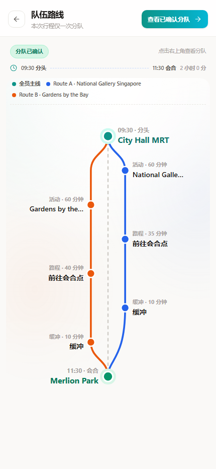

# E2E — US-086 队伍路线

- Date: 2026-11-17（+08:00）
- Environment: backend 8080（隔离 SQLite `backend/data/e2e-us086.db`，Flyway 全量种子）、Vite 5174、Chrome headless + CDP；账号 `alice@example.com`（组织者）与 `eve@example.com`（非成员），密码 `gogo-demo-2026`
- UI: `http://localhost:5174/trips/{id}/split`
- Reference: `ui-design-reference/screenshots/screen-11-split-start.png`

## Results

| id | 场景 | 结果 | 证据 |
|---|---|---|---|
| E1 | 无草稿、主线已确认（trip 3） | **Pass** | 标题「队伍路线」；右上「发起分队」；4 个主线节点（City Hall MRT → National Gallery → Gardens → Merlion）；图例仅「全员主线」，无 A/B |
| E2 | 无已确认主线（trip 2 未生成前） | **Pass** | 右上按钮 disabled；前置态「主线方案未确认」；无路线图；提示「先确认主线方案」 |
| E3 | `active` 无边界（trip 1 发起后） | **Pass** | 「继续分队」；2 个主线节点；提示「待选择分头 / 会合边界」；无分叉/会合节点 |
| E4 | `active` 有边界无路线（trip 1 保存边界后） | **Pass** | 摘要 09:30 分头 → 11:30 会合 · 2 小时；分头/会合节点 + 暂停段；A/B 提示「路线待生成」 |
| E5 | 两条路线已生成（trip 1） | **Pass** | Route A 右、Route B 左；分支「活动 60 分 → 路程（15+20 / 20+20）→ 缓冲 10 分」；主线文字左右交替；截图见下 |
| E6 | 状态动作 | **Pass** | confirmed → `/split/confirm` 且无发起入口；cancelled → 发起后进入 `/split/boundaries`；active → `/split/boundaries` |
| E7 | 权限 / 缺失 / 失败 | **Partial** | 404 trip 999 → `TRIP_NOT_FOUND` + 重试；Eve 访问 trip 1 → `NOT_A_MEMBER` + 重试；未模拟断网/5xx |
| E8 | 节点只读 | **Pass** | 路线图内 `[onclick]` / `[role=button]` 数量 = 0；无弹层、无任务/费用/地点 |
| E9 | 已取消（trip 2） | **Pass** | 「上次草稿已取消」；仅 4 个主线节点；图例无 A/B；「发起分队」可替换 |
| E10 | 分队 tab 直达 | **Pass** | `/#/trips/1` 的分队 tab href = `/trips/1/split`；点击后直接进入队伍路线，无「分队规划」中间页 |
| E11 | 拆分流程 chrome | **Pass** | `/split`、`/split/confirm` 均无「已登录 · 姓名」身份条 |
| E12 | confirmed 复核页 | **Pass** | header 无返回按钮；顶部「已确认」；底部「返回分队首页」仍可用 |
| E13 | 行程详情旧入口 | **Pass** | `/#/trips/1` 不再出现「分队规划」区块；confirmed 队伍路线页无重复「本页为只读路线」提示卡 |
| R1 | 分队 12–15 屏回归 | **Partial** | `/split/boundaries`、`/split/routes`、`/split/timing`、`/split/confirm` 均正常渲染；未重复执行完整生成/确认动作链 |
| R2 | 返回上下文（US-082） | **Pass** | 入口页返回 → `/#/trips/1` 行程详情 |

## Screenshot

## Notes / residuals

- 观察（非本 change）：一次全页深链打开出现 AuthProvider 检查竞态，短暂落到 `/#/`；重试后正常。属既有登录守卫行为，未在本故事修复。
- E7 的网络/5xx 分支未构造；ErrorState 复用既有可重试组件。
- 所有浏览器状态通过隔离 DB 构造，未修改演示库 `backend/data/gogo.db`。
