# 共享旅行应用 - 第 1 轮用户故事详情

本文件详细说明第 1 轮原有 39 条故事，并附加本轮新增的 US-073 至 US-080。新增故事尚未纳入原列表，编号需与项目看板保持一致。

每条验收标准均按“给定 / 当 / 那么”编写。原型 Release 2 截图用于说明界面方向，不额外增加功能要求；原型中的演示数据、按钮和模拟结果不能替代验收标准。

## 1. 行程设置与基本信息

### US-003：重命名行程
**所需部分：** 前端：是 | 后端：是 | 数据库：是（读取/写入）
作为行程组织者，我希望在主线方案确认前修改行程名称，这样朋友就能通过最新名称认出这个行程。

**原型参考：** [屏幕 03 - 行程详情](../../ui-design-reference/screenshots/screen-03-detail.png)

**验收标准：**
- 给定主线方案尚未确认且我是组织者，当我把行程名称改为“海边周末游”并保存时，那么新名称会保存，并在行程详情中显示。
- 给定主线方案已经确认，当我尝试修改行程名称时，那么修改会被拒绝，已保存名称保持不变。

### US-004：更改目的地
**所需部分：** 前端：是 | 后端：是 | 数据库：是（读取/写入）
作为行程组织者，我希望在主线方案确认前更改目的地，这样我们可以按已经商定的地点规划行程。

**原型参考：** [屏幕 02 - 行程信息表单](../../ui-design-reference/screenshots/screen-02-create.png)

**验收标准：**
- 给定主线方案尚未确认且我是组织者，当我把目的地改为大家商定的地点并保存时，那么新目的地会保存并显示在行程详情中。
- 给定主线方案已经确认，当我尝试更改目的地时，那么修改会被拒绝，已确认行程的信息不变。

### US-005：更改行程日期
**所需部分：** 前端：是 | 后端：是 | 数据库：是（读取/写入）
作为行程组织者，我希望在主线方案确认前更改行程日期，并确保结束日期不早于开始日期，这样行程时间就符合大家商定的安排。

**原型参考：** [屏幕 02 - 行程日期](../../ui-design-reference/screenshots/screen-02-create.png)

**验收标准：**
- 给定主线方案尚未确认且我是组织者，当我设置结束日期为开始日期当天或之后并保存时，那么新日期会保存并显示。
- 给定结束日期早于开始日期，当我保存日期时，那么系统显示验证错误，不保存无效日期。
- 给定主线方案已经确认，当我尝试更改日期时，那么修改会被拒绝。

### US-006：更改出发地点
**所需部分：** 前端：是 | 后端：是 | 数据库：是（读取/写入）
作为行程组织者，我希望在主线方案确认前更改出发地点，这样行程就能从大家商定的地点开始。

**原型参考：** [屏幕 02 - 行程信息表单](../../ui-design-reference/screenshots/screen-02-create.png)

**验收标准：**
- 给定主线方案尚未确认且我是组织者，当我更新出发地点并保存时，那么新地点会显示在行程详情中。
- 给定主线方案已经确认，当我尝试更改出发地点时，那么修改会被拒绝，原地点保持不变。

### US-007：更改结束地点
**所需部分：** 前端：是 | 后端：是 | 数据库：是（读取/写入）
作为行程组织者，我希望在主线方案确认前更改结束地点，这样行程就能在大家商定的最终地点结束。

**原型参考：** [屏幕 02 - 行程信息表单](../../ui-design-reference/screenshots/screen-02-create.png)

**验收标准：**
- 给定主线方案尚未确认且我是组织者，当我更新结束地点并保存时，那么新地点会显示在行程详情中。
- 给定主线方案已经确认，当我尝试更改结束地点时，那么修改会被拒绝，原地点保持不变。

### US-017：确认后保留行程基本信息
**所需部分：** 前端：是 | 后端：是 | 数据库：是（读取）
作为行程成员，我希望主线方案确认后行程基本信息保持不变，这样已确认的行程仍与规划时使用的信息一致。

**原型参考：** [屏幕 03 - 行程详情](../../ui-design-reference/screenshots/screen-03-detail.png)；[屏幕 10 - 主线方案](../../ui-design-reference/screenshots/screen-10-review.png)

**验收标准：**
- 给定主线方案已确认，当成员查看行程详情时，那么名称、目的地、日期和起终点与确认方案所用信息一致。
- 给定主线方案已确认，当任何成员尝试修改行程基本信息时，那么修改会被拒绝，已确认信息不变。

### US-018：确认后关闭加入入口
**所需部分：** 前端：是 | 后端：是 | 数据库：是（读取）
作为行程组织者，我希望主线方案确认后关闭加入入口，这样已确认的方案和分组不会因新成员加入而改变。

**原型参考：** [屏幕 04 - 邀请朋友](../../ui-design-reference/screenshots/screen-04-invite.png)；[屏幕 10 - 主线方案](../../ui-design-reference/screenshots/screen-10-review.png)

**验收标准：**
- 给定主线方案尚未确认且邀请有效，当受邀者接受邀请时，那么在符合邀请规则的情况下可以加入。
- 给定主线方案已经确认，当非成员使用此前有效的邀请加入时，那么加入会被拒绝，成员列表和已确认分组不变。

## 2. 邀请与加入

### US-009：预览行程邀请
**所需部分：** 前端：是 | 后端：是 | 数据库：是（读取）
作为受邀旅行者，我希望通过有效邀请查看有限的行程预览，这样我可以决定是否加入，同时不会看到私人行程安排。

**原型参考：** [屏幕 05 - 邀请预览与加入](../../ui-design-reference/screenshots/screen-05-join.png)

**验收标准：**
- 给定邀请有效且我还不是行程成员，当我打开邀请时，那么我可以看到用于识别行程的有限公开信息。
- 给定我尚未加入行程，当我查看邀请预览时，那么我看不到私人行程安排、成员偏好或完整路线。

### US-011：撤销邀请
**所需部分：** 前端：是 | 后端：是 | 数据库：是（读取/写入）
作为行程组织者，我希望撤销邀请链接，这样其他人之后就不能再通过该链接加入行程。

**原型参考：** [屏幕 04 - 邀请朋友](../../ui-design-reference/screenshots/screen-04-invite.png)

**验收标准：**
- 给定我是行程组织者且邀请仍有效，当我撤销邀请时，那么该邀请状态会更新为已撤销。
- 给定邀请已撤销，当受邀者随后打开或使用该链接时，那么系统拒绝加入，并且不显示私人行程信息。

## 3. 成员、准备状态与访问权限

### US-014：查看偏好提交状态
**所需部分：** 前端：是 | 后端：是 | 数据库：是（读取）
作为行程成员，我希望查看每位旅行者是否已经准备好，或仍需提交信息，这样我们能在开始规划前知道还缺少谁的意见。

**原型参考：** [屏幕 07 - 成员与就绪状态](../../ui-design-reference/screenshots/screen-07-members.png)

**验收标准：**
- 给定行程有多位成员，当我查看成员准备状态时，那么每位成员都显示为已就绪或待提交。
- 给定一位成员尚未提交偏好或明确选择无偏好，当我查看其状态时，那么该成员显示为待提交，而不是默认就绪。

### US-015：保护行程隐私
**所需部分：** 前端：是 | 后端：是 | 数据库：是（读取）
作为行程成员，我希望只有成员才能查看私人行程详情和规划信息，这样行程外的人就无法看到我们的安排。

**原型参考：** [屏幕 03 - 行程详情](../../ui-design-reference/screenshots/screen-03-detail.png)；[屏幕 05 - 邀请预览与加入](../../ui-design-reference/screenshots/screen-05-join.png)

**验收标准：**
- 给定我是行程成员，当我查看行程详情和规划信息时，那么我可以看到自己有权访问的内容。
- 给定我不是行程成员，当我直接请求私人行程或规划信息时，那么访问会被拒绝，响应中不包含这些信息。
- 给定我尚未接受邀请，当我查看邀请预览时，那么我只能看到有限的公开信息。

### US-016：保护共享行程信息不被他人修改
**所需部分：** 前端：是 | 后端：是 | 数据库：是（读取）
作为行程组织者，我希望只有组织者能修改共享的行程基本信息，这样其他成员就不能覆盖大家已经商定的内容。

**原型参考：** [屏幕 03 - 行程详情](../../ui-design-reference/screenshots/screen-03-detail.png)

**验收标准：**
- 给定我是组织者且主线方案尚未确认，当我修改行程基本信息时，那么有效修改会被保存。
- 给定我是普通成员，当我尝试通过界面或直接请求修改共享行程基本信息时，那么请求会被拒绝，原信息不变。

## 4. 个人偏好与限制

### US-021：记录我的可用时间
**所需部分：** 前端：是 | 后端：是 | 数据库：是（读取/写入）
作为行程成员，我希望保存自己的可用时间，这样行程就不会安排我参加无法出席时段内的活动。

**原型参考：** [屏幕 08 - 个人偏好](../../ui-design-reference/screenshots/screen-08-preferences.png)

**验收标准：**
- 给定主线方案尚未确认，当我填写并保存可用时间时，那么该时间会与我的偏好一起保存，重新打开后仍可查看。
- 给定我在某个时段不可用，当系统生成我的路线时，那么路线不会要求我参加该时段内的活动。

### US-022：记录我的行动限制
**所需部分：** 前端：是 | 后端：是 | 数据库：是（读取/写入）
作为行程成员，我希望记录必须遵守的行动限制，例如需要无台阶通道，这样已知不适合我的活动就不会被安排进我的路线。

**原型参考：** [屏幕 08 - 个人偏好](../../ui-design-reference/screenshots/screen-08-preferences.png)

**验收标准：**
- 给定主线方案尚未确认，当我保存一项行动限制时，那么该限制会保存在我的偏好中。
- 给定某活动已知违反我的硬性行动限制，当系统为我安排路线时，那么该活动不会被安排给我。

### US-023：记录我的饮食限制
**所需部分：** 前端：是 | 后端：是 | 数据库：是（读取/写入）
作为行程成员，我希望保存自己的饮食限制，这样推荐的餐饮活动就会考虑我能吃什么。

**原型参考：** [屏幕 08 - 个人偏好](../../ui-design-reference/screenshots/screen-08-preferences.png)

**验收标准：**
- 给定主线方案尚未确认，当我填写并保存饮食限制时，那么限制会保存在我的偏好中，重新打开后仍可查看。
- 给定系统推荐餐饮活动时，那么推荐会考虑已保存的饮食限制；适合情况未知时应明确标出未知。

### US-025：选择我的出行方式偏好
**所需部分：** 前端：是 | 后端：是 | 数据库：是（读取/写入）
作为行程成员，我希望保存基本的出行方式偏好，这样路线中的交通时间估算能符合我计划使用的交通方式。

**原型参考：** [屏幕 08 - 个人偏好](../../ui-design-reference/screenshots/screen-08-preferences.png)

**验收标准：**
- 给定主线方案尚未确认，当我选择并保存出行方式偏好时，那么该偏好会被保存并可再次查看。
- 给定路线需要估算地点间的交通时间，当系统生成估算时，那么估算会采用我保存的出行方式偏好。

### US-028：更新尚未确认的个人偏好
**所需部分：** 前端：是 | 后端：是 | 数据库：是（读取/写入）
作为行程成员，我希望在主线方案确认前只能修改自己的偏好，这样规划会使用最新信息，并重新生成基于旧信息的草稿路线。

**原型参考：** [屏幕 08 - 个人偏好](../../ui-design-reference/screenshots/screen-08-preferences.png)；[屏幕 10 - 主线方案](../../ui-design-reference/screenshots/screen-10-review.png)

**验收标准：**
- 给定主线方案尚未确认，当我修改自己的偏好并保存时，那么新偏好会保存，基于旧偏好生成的草稿会标记为过期或需要重新生成。
- 给定主线方案尚未确认，当我尝试修改其他成员的偏好时，那么修改会被拒绝。
- 给定主线方案已经确认，当我尝试修改自己的偏好时，那么修改会被拒绝。

### US-029：确认后保留个人偏好
**所需部分：** 前端：是 | 后端：是 | 数据库：是（读取）
作为行程成员，我希望主线方案确认后个人偏好保持锁定，这样大家确认的计划会继续使用一致的信息。

**原型参考：** [屏幕 08 - 个人偏好](../../ui-design-reference/screenshots/screen-08-preferences.png)；[屏幕 10 - 主线方案](../../ui-design-reference/screenshots/screen-10-review.png)

**验收标准：**
- 给定主线方案已经确认，当成员查看自己的偏好时，那么偏好仍可查看且与生成已确认方案时一致。
- 给定主线方案已经确认，当成员尝试修改偏好时，那么修改会被拒绝，已确认的计划和偏好不变。

## 5. 主线行程生成与查看

### US-030：指出规划所需信息是否缺失
**所需部分：** 前端：是 | 后端：是 | 数据库：是（读取）
作为行程组织者，我希望在生成路线前看到缺少的行程信息或成员回复，这样我可以先补齐信息，避免得到不完整的方案。

**原型参考：** [屏幕 07 - 成员与就绪状态](../../ui-design-reference/screenshots/screen-07-members.png)；[屏幕 09 - 生成主线](../../ui-design-reference/screenshots/screen-09-generate.png)

**验收标准：**
- 给定行程信息或成员回复尚未齐全，当我查看生成主线页面时，那么页面会指出缺少的内容或仍待回复的成员。
- 给定存在必需信息缺失，当我请求生成主线时，那么系统阻止生成并说明需要补齐的项目，不保存不完整方案。

### US-032：查看主线时间安排
**所需部分：** 前端：是 | 后端：是 | 数据库：是（读取）
作为行程成员，我希望查看活动地点、开始和结束时间以及交通路段，这样我能了解完整的共享行程安排。

**原型参考：** [屏幕 10 - 主线方案](../../ui-design-reference/screenshots/screen-10-review.png)

**验收标准：**
- 给定主线方案已生成，当成员打开主线时间安排时，那么每个活动都显示地点、开始和结束时间以及相关交通路段。
- 给定行程跨越多天，当成员查看主线时间安排时，那么每一天的活动都按日期清楚显示。

### US-033：查看必做活动是否已安排
**所需部分：** 前端：是 | 后端：是 | 数据库：是（读取）
作为行程成员，我希望查看哪些必做活动已经安排，以及其他活动未能安排的原因，这样重要需求就不会在没有说明的情况下被遗漏。

**原型参考：** [屏幕 10 - 主线方案](../../ui-design-reference/screenshots/screen-10-review.png)；[屏幕 13 - 分队路线](../../ui-design-reference/screenshots/screen-13-routes.png)

**验收标准：**
- 给定成员提交了必做活动，当成员查看方案时，那么每项必做活动都标明已安排或未安排。
- 给定某项必做活动未安排，当成员查看该项时，那么系统显示未安排的原因，不会静默省略。

### US-034：查看费用和未知价格
**所需部分：** 前端：是 | 后端：是 | 数据库：是（读取）
作为行程成员，我希望分别查看预估费用、已知费用小计和未知价格，这样不会把价格未知误认为免费，也不会误以为一定符合预算。

**原型参考：** [屏幕 10 - 主线方案](../../ui-design-reference/screenshots/screen-10-review.png)；[屏幕 13 - 分队路线](../../ui-design-reference/screenshots/screen-13-routes.png)

**验收标准：**
- 给定方案中包含已知价格和未知价格，当成员查看费用时，那么已知费用小计与未知价格分别显示。
- 给定活动价格未知，当成员查看费用时，那么该价格明确显示为未知，而不是显示为免费或计入已知小计。

### US-035：重试失败的主线生成
**所需部分：** 前端：是 | 后端：是 | 数据库：是（读取/写入）
作为行程组织者，我希望看到路线生成失败的提示，并能重新尝试，同时不接受不完整的方案，这样失败的请求不会留下需要照着执行的残缺行程。

**原型参考：** [屏幕 09 - 生成主线](../../ui-design-reference/screenshots/screen-09-generate.png)

**验收标准：**
- 给定主线生成请求失败，当我查看生成结果时，那么系统显示失败提示和重试操作。
- 给定生成只返回部分活动或保存失败，当请求结束时，那么部分结果不会显示为可确认的完整方案。
- 给定我选择重试且生成成功，当重试完成时，那么系统显示完整的新草稿供审阅。

### US-036：重新生成未确认的主线方案
**所需部分：** 前端：是 | 后端：是 | 数据库：是（读取/写入）
作为行程组织者，我希望用新生成的草稿替换尚未确认的方案，这样大家可以先查看修改后的提议，再决定是否接受。

**原型参考：** [屏幕 09 - 生成主线](../../ui-design-reference/screenshots/screen-09-generate.png)；[屏幕 10 - 主线方案](../../ui-design-reference/screenshots/screen-10-review.png)

**验收标准：**
- 给定当前主线草稿尚未确认，当我请求重新生成且生成成功时，那么新草稿替换旧草稿并可供审阅，但不会自动确认。
- 给定重新生成失败或只返回部分结果，当请求结束时，那么系统不会把不完整结果设为当前可确认草稿。

## 6. 分队设置与成员分组

### US-040：选择我的分队
**所需部分：** 前端：是 | 后端：是 | 数据库：是（读取/写入）
作为行程成员，我希望在分队草稿阶段选择或更换自己所在的小组，这样我可以和兴趣相近的朋友同行；分组变化后，系统会重新生成过期路线。

**原型参考：** [屏幕 13 - 分组与路线](../../ui-design-reference/screenshots/screen-13-routes.png)

**验收标准：**
- 给定分队仍是草稿，当我选择或更换自己的小组时，那么该成员只属于所选小组，分组变化会使旧路线失效或要求重新生成。
- 给定分队已经确认，当我尝试更换小组时，那么修改会被拒绝，已确认路线不变。

### US-041：查看成员分组
**所需部分：** 前端：是 | 后端：是 | 数据库：是（读取）
作为行程组织者，我希望看到两个小组都至少有一名成员，并且每位成员只分到一个组，这样不会有人被遗漏，也不会有人需要同时走两条路线。

**原型参考：** [屏幕 13 - 分组与路线](../../ui-design-reference/screenshots/screen-13-routes.png)；[屏幕 15 - 确认分队](../../ui-design-reference/screenshots/screen-15-confirm.png)

**验收标准：**
- 给定组织者查看分组草稿时，那么系统显示每位成员所属的小组。
- 给定任一小组没有成员，或有成员未分组、重复分组，当组织者尝试确认分队时，那么确认会被阻止并指出分组问题。
- 给定每组至少有一名成员且每位成员只分到一组，当组织者查看分组时，那么分组可供检查和确认。

## 7. 分队路线生成与检查

### US-044：检查活动是否适合成员
**所需部分：** 前端：是 | 后端：是 | 数据库：否（检查已提供的快照或服务商数据）
作为行程成员，我希望系统根据已知营业时间和硬性限制检查活动，并标出适合情况未知的活动，这样我的路线就不会明知不适合仍安排我前往。

**原型参考：** [屏幕 13 - 分队路线](../../ui-design-reference/screenshots/screen-13-routes.png)；[屏幕 14 - 时间窗检查](../../ui-design-reference/screenshots/screen-14-window-check.png)

**验收标准：**
- 给定活动的营业时间和成员硬性限制数据已提供，当系统检查路线时，那么已知不适合的活动会被标出或阻止安排。
- 给定活动适合情况无法确定，当成员查看路线时，那么该活动明确标为未知，不会显示为已确认适合。

### US-045：检查我的全程预算
**所需部分：** 前端：是 | 后端：是 | 数据库：否（检查已提供的费用快照）
作为行程成员，我希望系统检查我所在分队的费用和剩余共享费用，而且不重复计算被替换的活动，这样已知的硬性超预算问题会阻止确认，软性超预算则会给出提醒。

**原型参考：** [屏幕 13 - 分队路线](../../ui-design-reference/screenshots/screen-13-routes.png)；[屏幕 15 - 确认分队](../../ui-design-reference/screenshots/screen-15-confirm.png)

**验收标准：**
- 给定路线包含分队费用、未被替换的共享费用和已替换活动费用，当系统检查预算时，那么只合计分队费用与仍适用的共享费用，不重复计算已替换活动。
- 给定总费用超过成员的硬性预算，当组织者尝试确认分队时，那么确认被阻止并显示超出金额。
- 给定总费用超过成员的软性预算，当成员查看检查结果时，那么系统显示提醒，但不把软性超预算当作硬性阻止。

### US-046：指出路线时间信息是否缺失
**所需部分：** 前端：是 | 后端：是 | 数据库：否（检查已提供的时间快照）
作为行程成员，我希望看到哪些关键活动时长或交通时间估算缺失，这样无法验证是否可行的路线就不会被说成可行或允许确认。

**原型参考：** [屏幕 14 - 时间窗检查](../../ui-design-reference/screenshots/screen-14-window-check.png)

**验收标准：**
- 给定路线缺少关键活动时长或交通时间，当系统检查路线时，那么缺少的具体时间信息会被指出。
- 给定关键时间信息缺失，当成员查看检查结果或尝试确认时，那么路线不会显示为已验证可行，确认也会被阻止。

### US-047：预览两条分队路线
**所需部分：** 前端：是 | 后端：是 | 数据库：是（读取）
作为行程成员，我希望比较两条生成路线的时间安排、成员分组、费用、必做活动覆盖情况和会合信息，这样我能在确认分队前了解完整方案。

**原型参考：** [屏幕 13 - 分队路线](../../ui-design-reference/screenshots/screen-13-routes.png)；[屏幕 15 - 确认分队](../../ui-design-reference/screenshots/screen-15-confirm.png)

**验收标准：**
- 给定两条分队路线已生成，当成员预览方案时，那么两条路线的时间安排、分组、费用、必做活动覆盖和会合信息都可查看。
- 给定成员不是行程成员，当其请求分队路线预览时，那么访问会被拒绝，不返回私人路线信息。

### US-048：重试失败的分队路线生成
**所需部分：** 前端：是 | 后端：是 | 数据库：是（读取/写入）
作为分队发起人，我希望路线生成失败后可以重试，而且失败时不会保留不完整、但看起来可以确认的路线组合，这样两个小组都能拿到完整方案。

**原型参考：** [屏幕 13 - 分队路线](../../ui-design-reference/screenshots/screen-13-routes.png)

**验收标准：**
- 给定任一小组路线生成失败，当生成请求结束时，那么系统显示失败信息，且不会保存一个可确认的单路线结果。
- 给定分队发起人重试且两条路线都生成成功，当请求完成时，那么两条路线作为完整的一对供成员预览。

## 8. 分队确认、取消与路线查看

### US-051：出发前取消已确认的分队
**所需部分：** 前端：是 | 后端：是 | 数据库：是（读取/写入）
作为行程组织者，我希望在分队出发前取消已确认的分队，并恢复原来的主线方案，这样大家可以纠正错误决定，并在需要时重新创建分队。

**原型参考：** [屏幕 15 - 分队确认状态](../../ui-design-reference/screenshots/screen-15-confirm.png)；[屏幕 16 - 分队进行中](../../ui-design-reference/screenshots/screen-16-during.png)

**验收标准：**
- 给定分队已确认但尚未出发且我是组织者，当我取消该分队时，那么分队路线停止生效，原主线恢复为当前路线。
- 给定分队已经出发，当我尝试取消已确认分队时，那么取消会被拒绝，当前行程状态不变。
- 给定我是普通成员，当我尝试取消已确认分队时，那么请求会被拒绝。

### US-052：查看分配给我的路线
**所需部分：** 前端：是 | 后端：是 | 数据库：是（读取）
作为行程成员，我希望打开已确认、分配给自己小组的路线，同时仍能查看两条分队路线和原来的主线，这样我知道该走哪条路线，也不会失去对整体行程的了解。

**原型参考：** [屏幕 16 - 我的完整路线](../../ui-design-reference/screenshots/screen-16-during.png)

**验收标准：**
- 给定我属于已确认分队中的一个小组，当我打开路线页面时，那么默认显示分配给我的小组路线。
- 给定分队已确认，当我查看路线页面时，那么我仍能查看另一条分队路线和原主线，且不能因此更改分组或路线。
- 给定没有已确认分队，当我打开该页面时，那么系统显示无已确认分队的状态，并提供返回主线的入口。

## 9. 会合、导航与继续共同出行

### US-053：查看会合信息
**所需部分：** 前端：是 | 后端：是 | 数据库：是（读取）
作为行程成员，我希望看到与另一组相同的已确认会合地点、日期、时间和时区，这样大家能确认何时、何地会合。

**原型参考：** [屏幕 16 - 分队进行中](../../ui-design-reference/screenshots/screen-16-during.png)；[屏幕 17 - 行程导航](../../ui-design-reference/screenshots/screen-17-navigation.png)

**验收标准：**
- 给定分队已确认，当任一成员查看会合信息时，那么地点、日期、时间和时区均与已确认边界一致。
- 给定两组成员分别查看会合信息，当他们查看同一分队时，那么两边显示相同的会合地点和时间。

### US-055：不开地图也能查看会合地点
**所需部分：** 前端：是 | 后端：否（在本地显示备用信息） | 数据库：否（复用已加载的会合信息）
作为行程成员，我希望在地图无法打开时仍能看到会合地址和坐标，这样我仍然可以找到会合地点。

**原型参考：** [屏幕 17 - 行程导航与会合地点](../../ui-design-reference/screenshots/screen-17-navigation.png)

**验收标准：**
- 给定会合信息已经加载且地图无法打开，当我查看会合导航时，那么页面仍显示会合地址和坐标。
- 给定地图打开失败，当我查看备用信息时，那么失败不会清除已加载的会合地点，也不会更改已确认分队。

### US-056：确认所有人已经会合
**所需部分：** 前端：是 | 后端：是 | 数据库：是（读取/写入）
作为行程组织者，我希望在无需每位成员单独使用应用签到的情况下确认大家都已到场，这样有人忘记签到也不会妨碍全组重新会合。

**原型参考：** [屏幕 17 - 确认到达会合点](../../ui-design-reference/screenshots/screen-17-navigation.png)

**验收标准：**
- 给定分队已确认且我是组织者，当我确认全组已经会合时，那么行程会记录已会合状态，不要求每位成员分别签到。
- 给定我是普通成员，当我尝试确认全组已经会合时，那么请求会被拒绝，共享会合状态不变。

### US-057：会合后继续共同路线
**所需部分：** 前端：是 | 后端：是 | 数据库：是（读取/写入）
作为行程组织者，我希望确认大家会合后，从会合地点继续主线方案，而且不自动更改之后的活动，这样大家能继续按已同意的计划同行。

**原型参考：** [屏幕 16 - 完整路线与会合后主线](../../ui-design-reference/screenshots/screen-16-during.png)；[屏幕 17 - 会合导航](../../ui-design-reference/screenshots/screen-17-navigation.png)

**验收标准：**
- 给定所有人已确认会合且我是组织者，当我继续共同路线时，那么路线从已确认的会合节点接回主线。
- 给定会合后主线仍有后续活动，当我继续行程时，那么后续活动保持原样，不会被系统自动改写。
- 给定会合尚未确认，当我尝试继续共同路线时，那么操作会被阻止，行程仍处于分队状态。

## 10. 行程结束与最终记录

### US-059：查看已完成的行程
**所需部分：** 前端：是 | 后端：是 | 数据库：是（读取）
作为行程成员，我希望在行程结束后查看最终主线方案和分队路线，这样我可以回顾实际走过的行程。

**原型参考：** [屏幕 18 - 行程完成与回顾](../../ui-design-reference/screenshots/screen-18-complete.png)

**验收标准：**
- 给定行程已完成且我是成员，当我打开行程记录时，那么我可以查看最终主线方案。
- 给定已完成行程曾包含分队，当我查看行程记录时，那么最终分队路线也会保留并可查看。

### US-060：保留已完成的行程
**所需部分：** 前端：是 | 后端：是 | 数据库：是（读取）
作为行程成员，我希望已完成的行程不再允许修改规划，这样最终行程能作为准确的共享记录保留下来。

**原型参考：** [屏幕 18 - 行程完成与回顾](../../ui-design-reference/screenshots/screen-18-complete.png)

**验收标准：**
- 给定行程已经完成，当成员查看行程时，那么最终主线和分队记录仍可读取。
- 给定行程已经完成，当任何成员尝试修改行程或规划时，那么修改会被拒绝，已保存的最终记录保持不变。

## 11. 第 1 轮新增：真实出行体验

以下故事补充原有规则。个人路线选择与个人偏好表单不同：分队草稿中成员选择自己的路线，已确认分队仍遵循 US-040；会合签到为自愿，不取代 US-056 的组织者确认。行程结束后的记录仍受 US-060 保护。

### US-073：校验活动与交通时间
**所需部分：** 前端：是 | 后端：是 | 数据库：是（读取）
作为行程组织者，我希望在确认前检查每天活动和活动间的交通时间，这样大家不会拿到有冲突或无法验证的行程。

**验收标准：**
- 给定两个活动时间重叠或间隔不足以完成交通，当我审阅路线时，那么系统标出相关活动并阻止确认。
- 给定关键交通时间未知或活动时间无效，当我尝试确认时，那么系统说明缺失或错误并阻止确认。
- 给定所有日期的时间有效且交通时间足够，当我重新校验时，那么时间检查通过，但其他确认条件仍需满足。

### US-074：记录活动实用信息
**所需部分：** 前端：是 | 后端：是 | 数据库：是（读取/写入）
作为行程成员，我希望查看活动地址、预订信息、营业时间、交通安排和费用，这样我能提前准备并找到地点。

**验收标准：**
- 给定成员有权编辑活动信息，当其保存地址、预订信息、营业时间、交通安排或费用时，那么行程成员可查看最新信息。
- 给定价格尚未填写，当成员查看活动或费用汇总时，那么价格显示为未知，已知小计不包含未知价格；费用规则仍遵循 US-034。

### US-075：记录行程变化并通知成员
**所需部分：** 前端：是 | 后端：是 | 数据库：是（读取/写入）
作为行程成员，我希望在天气、交通或预订变化时延迟、跳过或替换活动并说明原因，这样大家知道最新安排。

**验收标准：**
- 给定行程尚未完成且成员有权调整活动，当成员提交延迟、跳过或替换及原因时，那么系统记录变化、更新行程并通知其他成员。
- 给定变更影响时间或交通，当系统重新校验时，那么显示新的冲突或未知信息，不把不完整路线标记为有效。
- 给定行程已完成，当成员尝试更改活动时，那么操作被拒绝，最终记录不变。

### US-076：成员发起分队与选择路线
**所需部分：** 前端：是 | 后端：是 | 数据库：是（读取/写入）
作为行程成员，我希望自己发起分队并选择草稿中的路线，这样每个人都能选择适合自己的活动。

**验收标准：**
- 给定有可供分队的共同路线，当任何成员发起分队草稿时，那么系统允许该成员选择边界并参与分组。
- 给定分队是草稿，当成员更换自己的小组时，那么旧路线失效，重新生成后显示新的分组；成员不能替其他人选择。
- 给定分队已确认，当成员尝试直接更换已确认分组时，那么遵循 US-040；如需改变，应按现有规则取消或发起新的分队。

### US-077：针对活动提出冲突或建议
**所需部分：** 前端：是 | 后端：是 | 数据库：是（读取/写入）
作为行程成员，我希望针对某项活动提出冲突或替代建议，这样大家可在同一行程中讨论调整。

**验收标准：**
- 给定成员可查看主线草稿，当成员选择活动并提交说明时，那么其他成员可看到建议、活动和提交者。
- 给定建议尚未被采纳，当成员查看路线时，那么建议不会自动修改或确认活动。
- 给定成员希望选择不同路线，当分队仍是草稿时，那么成员可按 US-040 直接选择自己的小组。

### US-078：查看接下来的活动
**所需部分：** 前端：是 | 后端：是 | 数据库：是（读取）
作为行程成员，我希望在出行当天看到接下来的活动，这样我知道何时出发以及要和谁同行。

**验收标准：**
- 给定成员有当天路线，当其查看行程时，那么下一项显示活动名称、时间、地址、小组及根据已知交通时间计算的建议出发时间。
- 给定地址或交通时间未知，当成员查看下一项时，那么缺失信息显示为待确认，不伪造出发时间。
- 给定当天没有后续活动，当成员查看时，那么显示没有更多活动。

### US-079：通过地图和备用地址找到地点
**所需部分：** 前端：是 | 后端：是 | 数据库：是（读取）
作为行程成员，我希望打开地图并复制活动地址及会合说明，这样地图不可用时仍能找到朋友。

**验收标准：**
- 给定活动有可用地点，当成员打开导航时，那么地图链接使用该地点，并提供可复制地址和会合说明。
- 给定地图无法打开或地址不完整，当成员查看地点详情时，那么已加载的信息仍可查看，缺失部分标为待确认；会合备用信息仍遵循 US-055。

### US-080：自愿分享会合状态
**所需部分：** 前端：是 | 后端：是 | 数据库：是（读取/写入）
作为行程成员，我希望自愿标记已到达或晚到并附留言，这样大家能协调会合而不必共享实时位置。

**验收标准：**
- 给定分队已确认，当成员选择已到达或晚到并提交可选留言时，那么行程成员可查看该状态和留言。
- 给定成员没有签到，当组织者实际确认全员到场时，那么仍可按 US-056 确认会合。
- 给定成员使用状态功能，当其他成员查看时，那么系统不自动追踪或显示实时位置。

## Release 2 原型截图

以下截图对应上文引用的界面，均来自 Release 2 原型配套的截图目录。截图用于界面参考；验收行为以各故事的 Given/When/Then 为准。

### 屏幕 02 - 创建行程与基本信息
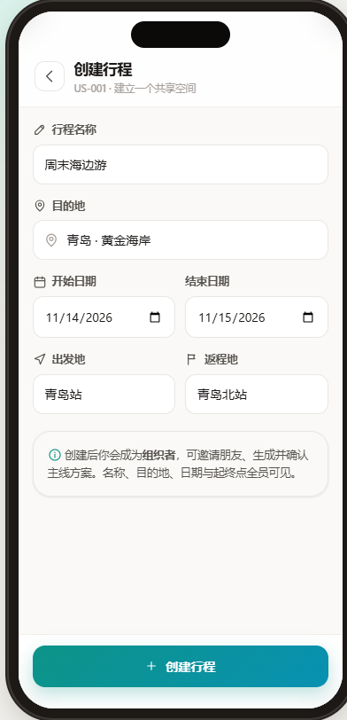

### 屏幕 03 - 行程详情
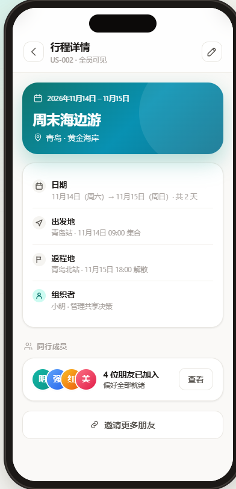

### 屏幕 04 - 邀请朋友
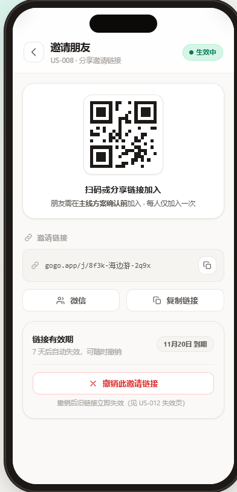

### 屏幕 05 - 邀请预览与加入
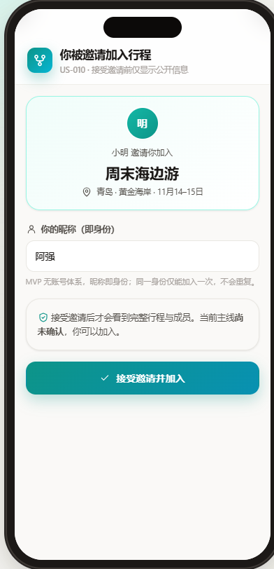

### 屏幕 07 - 成员与就绪状态
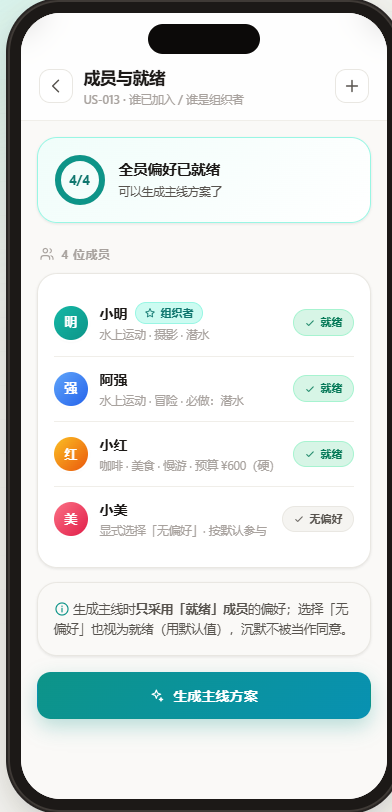

### 屏幕 08 - 个人偏好
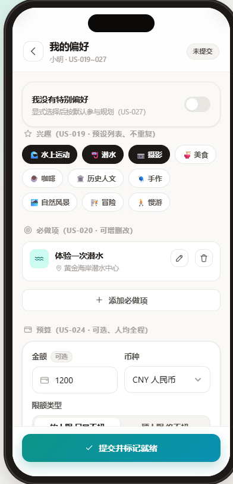

### 屏幕 09 - 生成主线
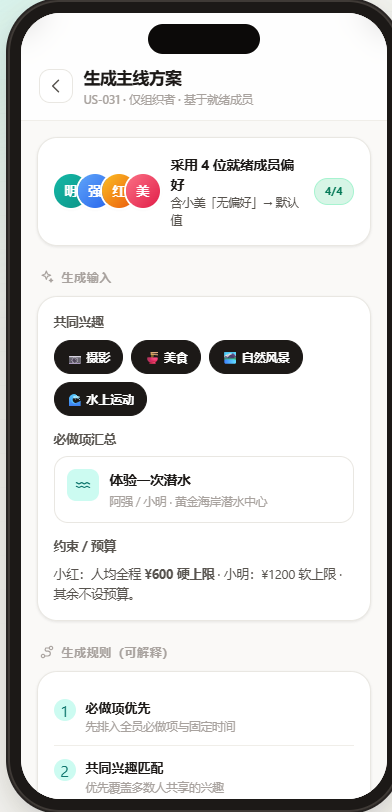

### 屏幕 10 - 主线方案
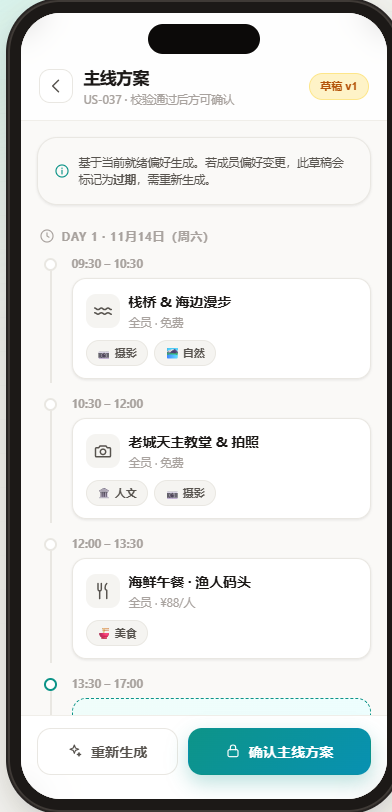

### 屏幕 13 - 分组与分队路线
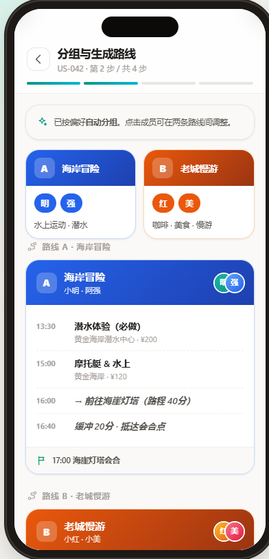

### 屏幕 14 - 会合时间窗检查
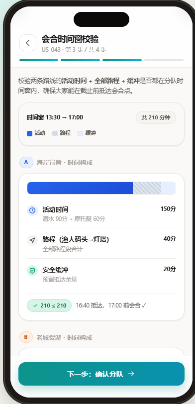

### 屏幕 15 - 确认分队
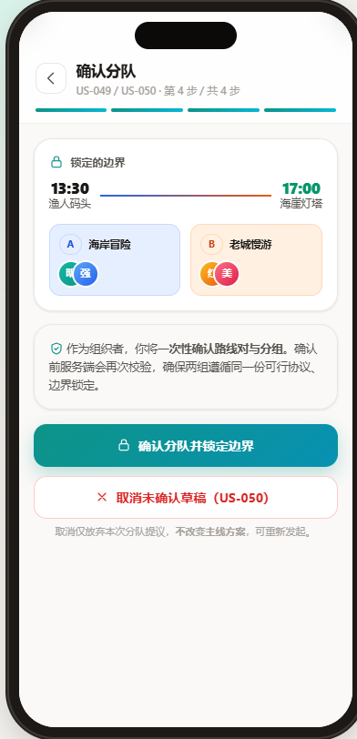

### 屏幕 16 - 分队进行中与路线查看
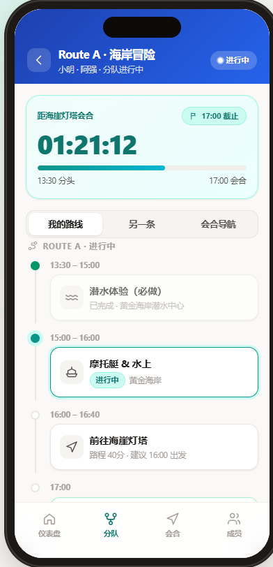

### 屏幕 17 - 导航与会合
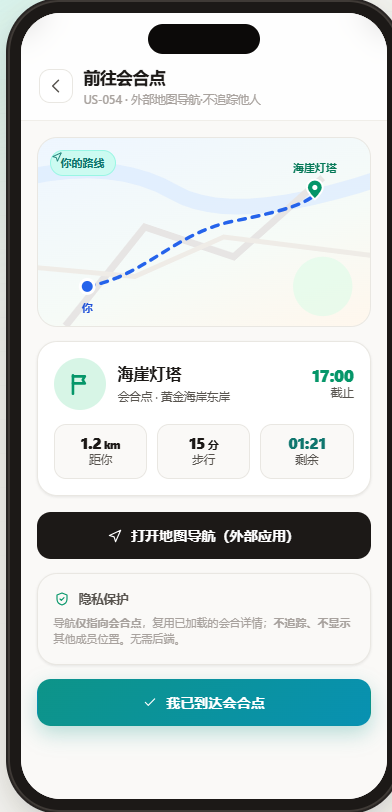

### 屏幕 18 - 行程完成与回顾
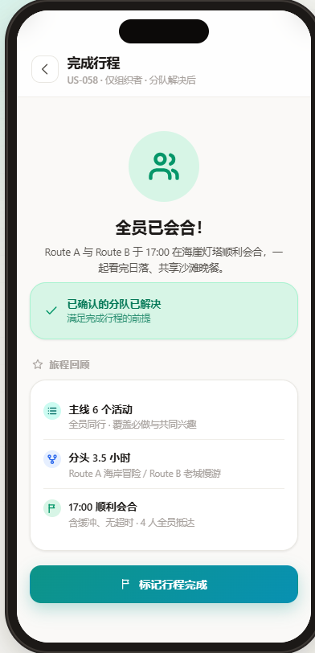