# GoGo 共享旅行 · 前端 UI 设计说明

这份文档讲清楚当前前端原型「长什么样、为什么这么设计、每个界面怎么运作」。
配套的可交互原型是 [`gogo-mvp-prototype.html`](gogo-mvp-prototype.html)，本文所有截图都来自它的最新状态（存放在 [`screenshots/`](screenshots/)）。

- **这是什么**：一个覆盖最终 MVP 全部 21 条 user story + 仪表盘首页的高保真前端原型，共 18 个可点击界面。
- **现在做到什么程度**：纯 UI、演示数据、不连后端；所有按钮 / 表单 / 校验 / 动画都真实可点，已在浏览器逐屏验证、控制台零报错。
- **怎么上手**：直接双击 `gogo-mvp-prototype.html` 即可（离线可开、零外部依赖、不用装任何东西）。打开后左边是手机框，右边是「原型导航」，点任意一项跳到对应界面；也可用键盘 `←` `→` 翻屏、`1`–`9` 直达前 9 屏。
- **注意什么**：数据是写死的演示行程「周末海边游」，只用于展示设计，不代表真实后端逻辑。
- **风格约定（重要）**：以后不管加新页面还是改老页面，UI 都**按照本参考当前的风格**设计——同一套颜色、圆角、阴影、字体、组件和动效，不另起一套视觉。本文件夹 `ui-design-reference` 就是全站 UI 的风格基准。

整页概览（手机框 + 右侧导航面板）：

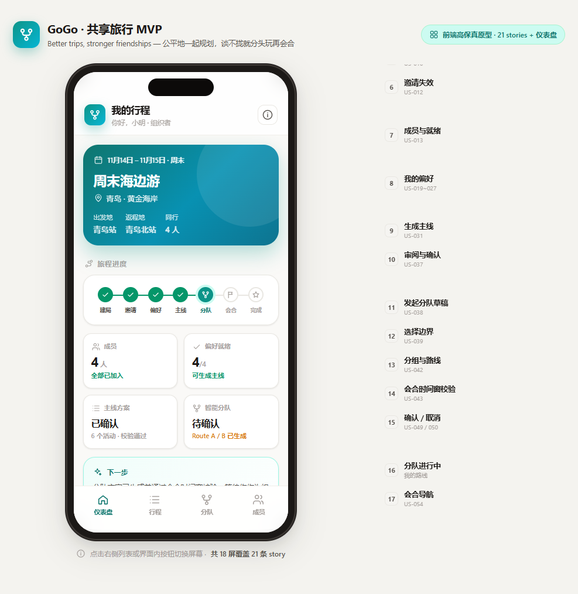

---

## 一、整体视觉语言

**本参考是全站 UI 的风格基准：后续所有 UI 设计一律沿用当前风格，只扩展内容、不改视觉语言。** 对齐 [shadcn/ui](https://ui.shadcn.com/docs) 的克制风格：中性暖灰底、圆角卡片、细描边、柔和阴影、留白充足；移动优先、单手可操作。在此基础上用「海洋青绿」做品牌主色，用「蓝 / 橙」两条高饱和色区分分队的两条路线，让界面一眼能认出是「一起旅行 + 分头玩」这件事。

### 1. 色彩系统

| 角色 | 变量 | 色值 | 用途 |
|---|---|---|---|
| 页面底 | `--bg` | `#f4f3ef` | 暖灰米白舞台背景 |
| 卡片面 | `--surface` / `-2` / `-3` | `#fff` / `#faf9f7` / `#f5f4f1` | 三级表面，区分卡片 / 次级块 / 输入底 |
| 主文字 | `--ink` | `#1c1917` | 标题、正文 |
| 次文字 | `--ink-2` / `--ink-3` | `#57534e` / `#a8a29e` | 说明文字 / 弱提示 |
| 描边 | `--line` / `--line-2` | `#e9e7e2` / `#f0eee9` | 卡片描边 / 分隔线 |
| 品牌主色 | `--brand` / `--brand-2` | `#0d9488` / `#06b6d4` | 青绿→青渐变，主按钮 / logo / 进度 |
| 品牌深 / 浅 | `--brand-ink` / `--brand-soft` | `#0f766e` / `#ccfbf1` | 品牌文字 / 品牌浅底 |
| 路线 A | `--a` / `-soft` / `-line` | `#2563eb` / `#e6efff` / `#c7dbff` | 海岸冒险（蓝） |
| 路线 B | `--b` / `-soft` / `-line` | `#ea580c` / `#fff0e2` / `#ffd9b8` | 老城慢游（橙） |
| 成功 | `--ok` / `--ok-soft` | `#059669` / `#d7f5e6` | 就绪 / 校验通过 / 会合 |
| 警告 | `--warn` / `--warn-soft` | `#d97706` / `#fef3c7` | 草稿 / 待确认 |
| 危险 | `--err` / `--err-soft` | `#dc2626` / `#fee2e2` | 校验失败 / 失效 / 撤销 |

约定：绿色只表示「通过 / 就绪 / 会合」，橙色只表示「路线 B 或待办」，红色只表示「错误 / 失效」，不混用，保证状态一眼可读。

### 2. 字体与数字

- 字体走系统栈：`-apple-system, "Segoe UI", "PingFang SC", "Microsoft YaHei", sans-serif`，不引外部字体，离线一致。
- 标题字重 700–780、正文 400–650，靠字重而非颜色拉层级。
- 所有时间 / 倒计时 / 金额用 `.count`（`font-variant-numeric: tabular-nums`），等宽数字跳动时不抖。

### 3. 圆角、阴影、图标

- 圆角四档：`10 / 14 / 20 / 26px`（小控件 / 卡片 / 大卡 / hero）。
- 阴影三级：`sh-1` 卡片微影、`sh-2` 悬浮面板、`sh-3` 手机框与 toast 强影。
- 图标为 40 个内联 SVG `<symbol>`（`#i-*`），统一 1.75 描边、圆头圆角，随文字色 `currentColor`，不引图标库。

### 4. 舞台与手机框

- 舞台 `.stage` 居中，顶部 masthead（logo +  slogan + 「21 stories + 仪表盘」标签）。
- 背景 `.ambient`：两团品牌色光晕（青绿 / 暖橙）+ 细网格，营造氛围但不抢内容。
- 手机框 `.phone`：392×812、圆角 52、黑色边框 + 顶部 dynamic island；内层 `.viewport` 圆角 40 承载屏幕。
- 右侧 `.panel`（336px、sticky）：原型导航（按 8 大类分组）+ 设计语言图例 + 范围约定。
- 响应式：`≤960px` 面板移到手机下方变两列；`≤440px` 手机框撑满宽度、导航变单列。

### 5. 屏幕骨架与动效

每个屏幕统一三段式：`.appbar`（毛玻璃顶栏：返回 / 标题 / 副标题 / 右侧状态或动作）→ `.body`（可滚动内容）→ `.actionbar`（底部主操作）或 `.tabbar`（底部四 tab）。分队流程另加 `.stepbar`（4 段进度条）标示「第几步 / 共 4 步」。

动效：切屏 `screenIn` 0.38s 位移淡入；成功环 `pop` 弹性放大；live 圆点 `pulse` 扩散；彩带 `fall` 下落旋转；进度条宽度 0.6s 缓动；toast 0.28s 上浮淡入。全部为 CSS/原生 JS，无动画库。

### 6. 通用组件

`card` 卡片、`btn`（primary 渐变 / dark / ghost / danger / a 蓝 / b 橙）、`pill` 状态徽章（ok/warn/err/a/b/brand）、`chip` 可选标签（选中反色）、`av` 头像（teal/blue/amber/rose 四色 + 叠放 avstack）、`field/input/select/textarea` 表单、`switch` 开关、`seg` 分段选择、`valid-item` 校验行（pass/fail/wait 三态图标）、`timeline/tl-item/act` 时间轴活动、`route` 路线卡（a/b 双色头）、`progress` 进度条、`mapcard` 地图卡、`toast` 提示、`member-row` 成员行、`mustdo` 必做项、`linkbox/qr` 链接与二维码。

---

## 二、逐节点设计细节（18 屏）

> 每屏给出：对应 story、截图、这屏干什么、布局与组件、状态与交互、体现的业务规则。

### 节点 1 · 仪表盘 Dashboard

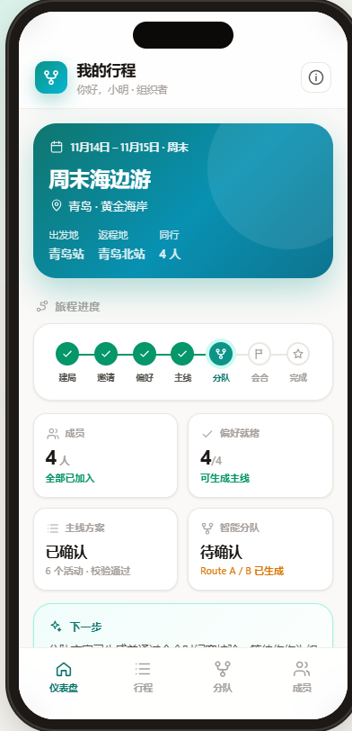

- **对应**：MVP 顶部要求的 dashboard 首页（总览入口）。
- **干什么**：一眼看到「这次旅行到哪一步了、下一步该做什么」，并快捷跳到任意功能。
- **布局与组件**：
  - `hero` 青绿渐变大卡：日期、行程名「周末海边游」、目的地、出发地 / 返程地 / 同行人数。
  - `journey` 七节点旅程进度（建局→邀请→偏好→主线→分队→会合→完成）：已完成绿勾、当前节点青绿 + 光环、未达灰色；每个节点可点击直达对应屏。
  - `stat-grid` 2×2 统计卡：成员 4 人、偏好就绪 4/4、主线「已确认」、分队「待确认」（橙色提示 Route A/B 已生成）。
  - 「下一步」引导卡（青绿描边 + 浅渐变）：说明当前该确认分队，主按钮直达节点 15。
  - `quick` 两列 8 个快捷入口卡（详情 / 邀请 / 成员 / 偏好 / 主线 / 分队 / 导航 / 完成），各带 story 编号小字。
  - 底部 `tabbar` 四 tab：仪表盘 / 行程 / 分队 / 成员。
- **状态与交互**：当前节点高亮「分队」；点进度节点、统计卡引导、快捷入口、tab 均跳屏。
- **规则体现**：把「就绪门控、主线已确认、分队待确认」这些全局状态浓缩成可读信号，并始终给出唯一下一步。

### 节点 2 · 创建行程（US-001）

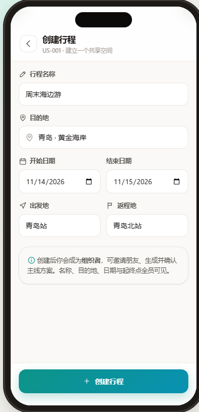

- **干什么**：建立一个共享旅行空间（名称 / 目的地 / 有效日期 / 起终点）。
- **布局与组件**：单列表单 `field`：行程名称、目的地（带定位图标输入）、开始 / 结束日期（`two` 两列 date）、出发地 / 返程地（两列）；底部灰卡说明「创建后你是组织者」；`actionbar` 主按钮「创建行程」。
- **状态与交互**：`createTrip()` 校验结束日期不得早于开始日期——违反时给结束日期字段加 `.invalid`（红描边 + 红晕）并显示 `err-msg`「结束日期不能早于开始日期」+ toast；通过则 toast「你是组织者」并跳节点 3。
- **规则体现**：US-001 的「有效日期」约束做成即时可见的字段级错误，而非提交后才报错。

### 节点 3 · 行程详情（US-002）

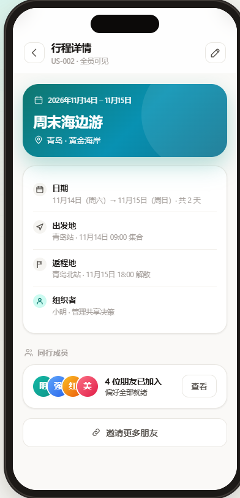

- **干什么**：全员查看已保存的行程基本信息。
- **布局与组件**：复用 `hero` 大卡；下方 `valid` 列表四行（日期 / 出发地 / 返程地 / 组织者），用中性图标 + 主副文案呈现只读信息；「同行成员」卡用 `avstack` 四头像 + 「4 位朋友已加入 / 偏好全部就绪」+ 查看按钮；底部「邀请更多朋友」ghost 按钮；顶栏右侧编辑图标回节点 2。
- **状态与交互**：只读展示；查看→节点 7、邀请→节点 4、编辑→节点 2。
- **规则体现**：US-002「全员可见」——名称 / 目的地 / 日期 / 起终点 / 组织者清晰罗列，不含私有偏好。

### 节点 4 · 分享邀请（US-008）

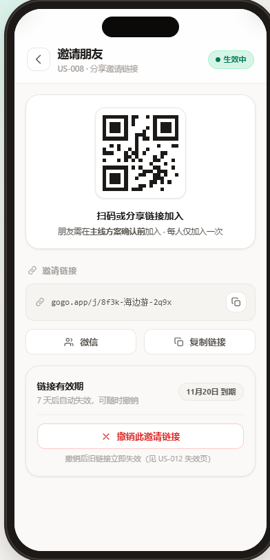

- **干什么**：组织者获取并分享邀请链接 / 二维码。
- **布局与组件**：顶栏 `pill ok`「生效中」；居中 `qr`（132px 白底圆角，JS 生成的 21×21 伪二维码 SVG）+ 「扫码或分享链接加入」+ 小字「主线确认前加入 · 每人仅一次」；`linkbox` 等宽字体链接 + 复制图标按钮；`two` 两列「微信 / 复制链接」；灰卡内 `switch-row` 链接有效期（7 天 / 到期 pill）+ 红色「撤销此邀请链接」按钮。
- **状态与交互**：`copyInvite()` 写剪贴板 + toast；撤销→节点 6（失效页）。
- **规则体现**：US-008 的链接可分享、可撤销、有有效期；加入时机与去重限制直接写在二维码下方。

### 节点 5 · 加入行程（US-010）

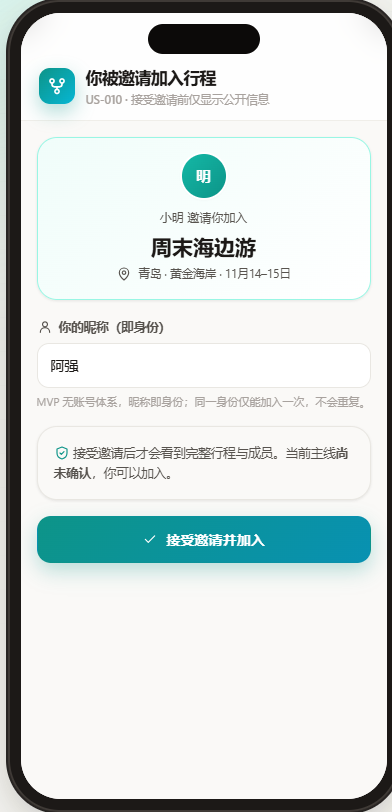

- **干什么**：被邀请者接受邀请、以昵称身份加入一次。
- **布局与组件**：邀请卡（组织者大头像 + 「小明邀请你加入」+ 行程名 + 目的地 / 日期公开信息）；`joinForm`：昵称输入（「昵称即身份」help）+ 隐私说明卡（「接受后才看到完整行程；当前主线尚未确认，可加入」）+ 主按钮「接受邀请并加入」；`joinDone`（隐藏）：成功环 + 「已加入」+ 「填写我的偏好 / 查看仪表盘」。
- **状态与交互**：`joinTrip()` 昵称为空则 toast 提示；否则隐藏表单、显示成功态 + toast「已以…身份加入（仅一次）」；成功态引导去节点 8 填偏好。
- **规则体现**：US-010「主线确认前可加入、仅一次、昵称即身份、接受前仅公开信息」全部落在文案与两态切换上。

### 节点 6 · 邀请失效（US-012）

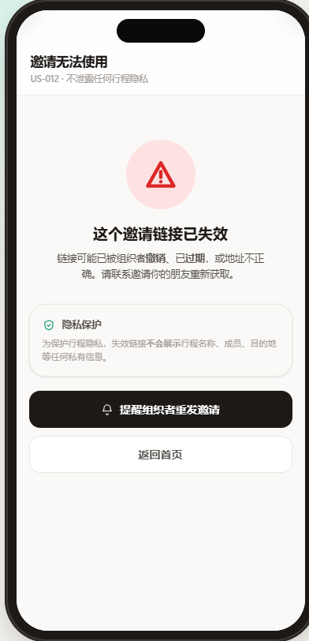

- **干什么**：告诉被邀请者链接不可用，且不泄露任何行程隐私。
- **布局与组件**：红色 `checkring`（alert 图标）+ 「这个邀请链接已失效」+ 原因说明（撤销 / 过期 / 地址不正确）；灰卡「隐私保护」明确「不展示行程名称、成员、目的地等私有信息」；dark 按钮「提醒组织者重发邀请」+ ghost「返回首页」。
- **状态与交互**：提醒按钮 toast 演示；返回→节点 1。
- **规则体现**：US-012 的核心是「失效但不泄密」——整屏只有通用文案，没有任何具体行程数据。

### 节点 7 · 成员与就绪（US-013）

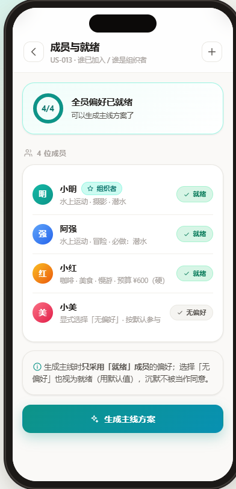

- **干什么**：看谁已加入、谁是组织者、谁已就绪。
- **布局与组件**：顶部就绪环（SVG 圆环 4/4，青绿 stroke）+ 「全员偏好已就绪 / 可以生成主线」；`member-row` ×4：头像 + 名字（小明带「组织者」brand pill）+ 兴趣 / 约束摘要 + 右侧状态 pill（前三人绿色「就绪」，小美灰色「无偏好」）；灰卡说明「只采用就绪成员；无偏好也算就绪；沉默≠同意」；主按钮「生成主线方案」。
- **状态与交互**：右上加号→节点 4 邀请；生成→节点 9。
- **规则体现**：US-013 成员 / 组织者可见；就绪门控与「无偏好=显式就绪」用不同 pill 区分，避免把沉默当同意。

### 节点 8 · 我的偏好（US-019~027）

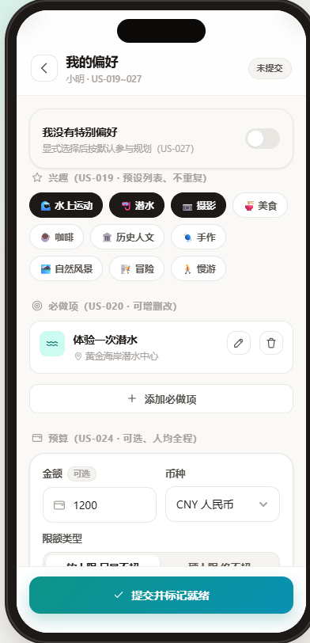

- **干什么**：成员填写兴趣 / 必做项 / 预算，或显式选择无偏好，然后提交标记就绪。
- **布局与组件**：
  - 顶部灰卡 `switch`「我没有特别偏好」（US-027）；打开后隐藏 `prefFields`、显示 `noPrefNote` 青绿卡（「沉默不会被当作同意」），提交按钮文案变为「确认无偏好并就绪」。
  - 兴趣 `chips`：10 个预设 emoji 标签（水上 / 潜水 / 摄影 / 美食 / 咖啡 / 人文 / 手作 / 自然 / 冒险 / 慢游），可多选、天然不重复（US-019）。
  - 必做项 `mustdoList` + 折叠 `mustdoForm`（名称 + 地点 / 固定时间「二选一」）+ 每项编辑 / 删除图标按钮（US-020）。
  - 预算卡：金额（number、min 0、可留空）+ 币种 select（CNY/USD/EUR/JPY）+ `seg` 软 / 硬上限 + help「非负、人均、全程；硬上限严格过滤」（US-024）。
  - 顶栏 `readyPill`「未提交」；`actionbar` 提交按钮（US-026）。
- **状态与交互**：`addMustdo()` 要求名称 + 至少地点或时间，否则 toast；`editMustdo/rmMustdo` 增删改；`submitPref()` 把 `readyPill` 变绿「就绪」+ toast，0.7s 后跳节点 7。
- **规则体现**：五条 story 合一屏；「可选预算」「显式无偏好」「提交即就绪」都用开关 / 留空 / 状态徽章表达，而非隐藏逻辑。

### 节点 9 · 生成主线（US-031）

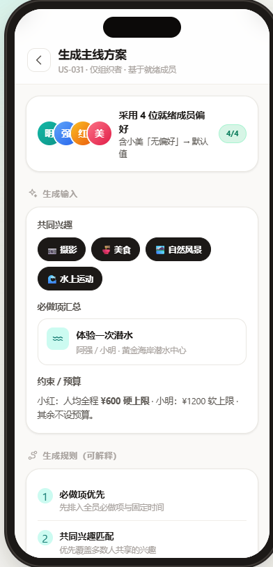

- **干什么**：组织者基于就绪成员偏好一键生成带时间的主线草稿。
- **布局与组件**：`genIdle`：采用成员卡（avstack + 「4 位就绪 / 含小美无偏好→默认」+ 4/4 pill）；「生成输入」卡（共同兴趣 chips、必做项汇总、约束 / 预算文字）；「生成规则（可解释）」卡用编号 1/2/3 校验行（必做优先→共同兴趣→约束过滤）；主按钮「一键生成」。`genProgress`（隐藏）：logo + `progress` 进度条 + 三条逐项打勾校验行。
- **状态与交互**：`generatePlan()` 切到进度态，进度条 8%→38%→70%→100%，三条校验依次 pass，约 2s 后自动跳节点 10。
- **规则体现**：US-031「仅组织者、仅就绪成员」写在副标题与采用卡；生成过程做成可解释的分步动画，而非黑盒转圈。

### 节点 10 · 主线审阅与确认（US-037）

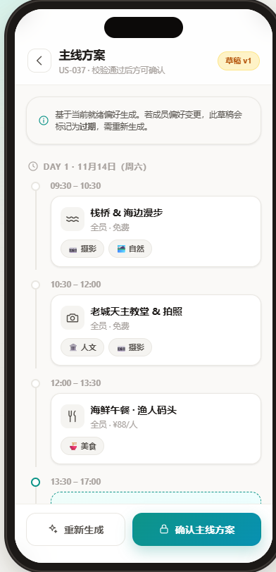

- **干什么**：审阅主线草稿，校验通过后才允许确认。
- **布局与组件**：顶栏 `planStatus` pill「草稿 v1」（warn 橙）；灰卡提示「偏好变更则草稿过期需重生成」；Day 1 `timeline` 六个活动（09:30 栈桥 / 10:30 教堂 / 12:00 海鲜午餐 / 13:30–17:00 自由活动 / 17:00 灯塔日落 / 19:00 沙滩晚餐），每个 `act` 带图标 / 价格 / 兴趣 tags；其中 13:30–17:00 用 `split-cta` 青绿虚线卡标「可分队 + 覆盖必做潜水」；「确认前校验」卡三条 `valid-item`（时间顺序 / 硬预算 / 必做覆盖）；`actionbar` 「重新生成」+「确认主线方案」（初始 disabled）。
- **状态与交互**：进入即跑 `validatePlan()`，三条校验依次 pass 后确认按钮才解禁；`confirmPlan()` 把状态 pill 变绿「已确认」+ toast，跳节点 11。
- **规则体现**：US-037「校验通过才能确认、不确认过期草稿」——确认按钮的禁用 / 解禁就是门控的可视化。

### 节点 11 · 队伍路线（US-038）

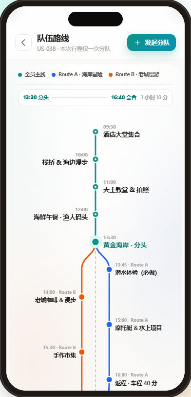

- **干什么**：用一张 git 风格的路线图展示全队从主线分头、A/B 并行到重新会合的完整线路；右上角「发起分队」进入分队设置。
- **布局与组件**：顶栏标题「队伍路线」+ 右上主按钮「发起分队」；`teamgraph` 区域不套卡片容器，直接铺在页面底上：图例（全员主线 / Route A 海岸冒险 / Route B 老城慢游）+ 分头–会合时间条 + `#teamRouteSvg` 路线图（14 个节点，蓝 A 在右、橙 B 在左，两条分叉线收拢在主线两侧；主线文字左右交替，分叉文字各靠外，分头段主线淡虚线表示暂停）。点击任意节点弹出 bottom sheet：路线徽章、时间、地点 / 同行 / 费用 pill、编号任务清单。
- **状态与交互**：`renderTeamRoute()` 生成 SVG 节点；节点点击 `openRouteNode()` 填充并打开 `#routeSheet`，点遮罩 / 关闭按钮 / `Esc` 收起；右上按钮 → 节点 12；返回 → 节点 10。
- **规则体现**：US-038「单次、从已确认主线、出发前或行程中」由副标题「本次行程仅一次分队」与右上唯一入口体现；git 图把「分头 → 并行 → 会合」结构直接可视化，每个节点可点开查看该点要做的事。

### 节点 12 · 选择分队边界（US-039）

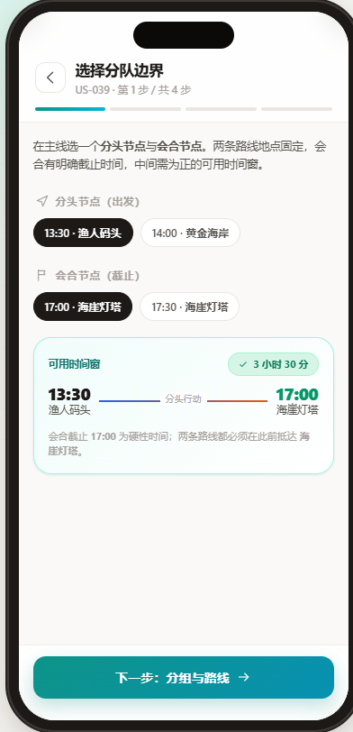

- **干什么**：选分头节点与会合节点，确定固定地点与正的时间窗。
- **布局与组件**：`stepbar` 第 1/4 步；「分头节点」`depChips` 与「会合节点」`reuChips` 单选 chip（带 data-min 分钟值）；时间窗卡：左起点时间 / 地点、右截止时间 / 地点、中间渐变连线 + 「分头行动」标签，右上 `winDur` pill 显示窗口时长；help 强调截止为硬性时间。
- **状态与交互**：`bindBoundary()` 监听 chip 选择，实时重算窗口（`winStart/End/Dur`、`deadlineTxt/meetLocTxt`）；窗口 ≤0 时 pill 变红「时间窗必须为正」。
- **规则体现**：US-039「固定地点 + 正时间窗 + 明确截止」做成随选随算的实时反馈。

### 节点 13 · 分组与生成路线（US-042）

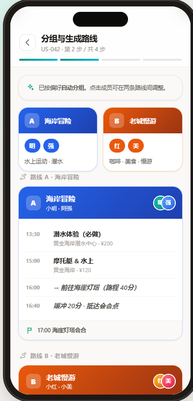

- **干什么**：自动按偏好分两组，可手动调整，再为每组各生成一条路线。
- **布局与组件**：`stepbar` 第 2/4 步；提示卡「已自动分组，点成员可调整」；`two` 两列分组卡（A 蓝 / B 橙头 + 成员 chip）；「生成两条路线」按钮；`routesResult`（生成后显示）两条 `route` 卡：双色渐变头（rcode + 名称 + 成员 avstack）、`rbody` 用 `mini` 时间行（活动 + 价格；路程 / 缓冲行用斜体 `leg`）、`rfoot` 绿旗「17:00 海崖灯塔会合」。
- **状态与交互**：点成员 chip 在 A/B 间互换（`bindGroups()` 改色 + 移动 + toast）；`genRoutes()` 显示两条路线；下一步→节点 14。
- **规则体现**：US-042「每组一条路线、用该组偏好 + 固定边界」——两条路线卡各自独立、颜色区分、都指向同一会合点。

### 节点 14 · 会合时间窗校验（US-043）

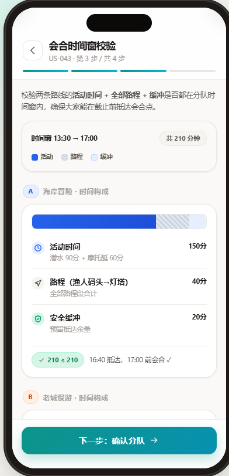

- **干什么**：校验两条路线「活动 + 全部路程 + 缓冲」是否都装得进时间窗。
- **布局与组件**：`stepbar` 第 3/4 步；时间窗卡（13:30→17:00 共 210 分钟）+ 图例（活动实色 / 路程斜纹 / 缓冲浅色）；A、B 各一张卡：顶部堆叠条按比例三段（A 71.4/19/9.6，B 76.2/16.7/7.1），下接三行校验（活动 150/160 分、路程 40/35 分、缓冲 20/15 分）+ 「210 ≤ 210」绿 pill + 抵达时间；底部绿卡「校验通过：两条路线均可行（基于快照、不写库）」。
- **状态与交互**：只读校验展示；下一步→节点 15。
- **规则体现**：US-043「活动 + 全部路程 + 缓冲 ≤ 窗口、不写数据库」——堆叠条 + 斜纹路程让时间构成可直接目视核对。

### 节点 15 · 确认 / 取消分队（US-049 / US-050）

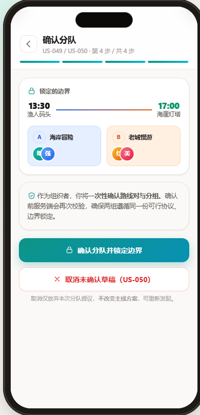

- **干什么**：组织者一次性确认路线对 + 分组（服务端再校验后锁边界），或取消未确认草稿。
- **布局与组件**：`stepbar` 第 4/4 步；「锁定的边界」卡（13:30 渔人码头 → 17:00 海崖灯塔 + A/B 两组 avstack）；`splitActions`：说明卡 + 主按钮「确认分队并锁定边界」+ 红色「取消未确认草稿」+ help「取消不改主线」；`splitReval`（隐藏）三条服务端再校验行；`splitDone`（隐藏）成功环「分队已生效」+ 「进入行程中视图」。
- **状态与交互**：`confirmSplit()` 隐藏操作区→跑 rv1-3 再校验→显示成功态 + toast；`cancelSplit()` toast「草稿已取消，主线不变」+ 回节点 10。
- **规则体现**：US-049「路线对 + 分组一起确认、服务端再校验、锁边界」与 US-050「可取消、不改主线」分成两条清晰路径。

### 节点 16 · 分队进行中 · 我的路线

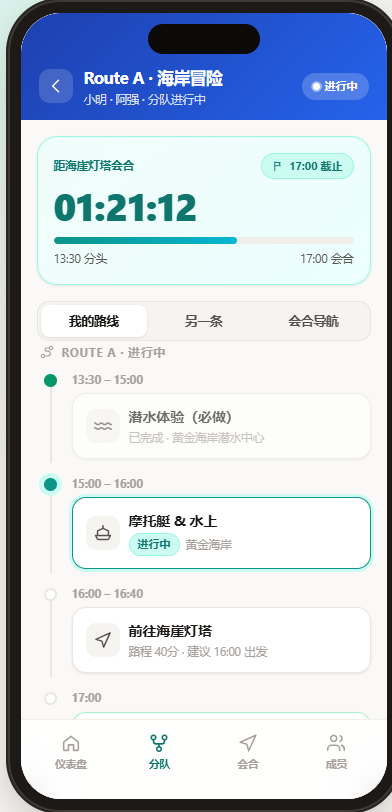

- **干什么**：分队生效后看自己这条路线的实时进度与会合倒计时。
- **布局与组件**：蓝色渐变 appbar（Route A · 海岸冒险 + live「进行中」pill）；倒计时卡（`cd16` 大号 HH:MM:SS + `cdBar` 进度条 + 13:30 分头 / 17:00 会合）；`seg` 三段（我的路线 / 另一条 / 会合导航）；`viewMine` 时间轴（已完成潜水 / 进行中摩托艇 / 前往灯塔 / 会合）；`viewOther`（隐藏）Route B 路线卡 + 隐私卡「仅展示计划路线，不追踪实时位置」；底部 tabbar。
- **状态与交互**：倒计时每秒递减（`tick()`）；分段切换我的 / 另一条；会合导航→节点 17。
- **规则体现**：进行中只给「我的进度 + 对方计划」，明确不追踪他人位置，保护隐私。

### 节点 17 · 会合导航（US-054）

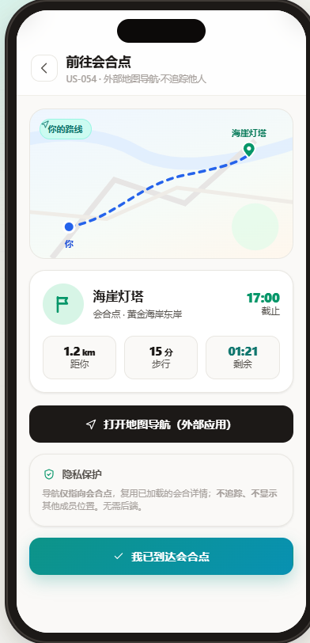

- **干什么**：打开外部地图导航去会合点，不追踪其他成员。
- **布局与组件**：`mapcard`（190px  SVG 地图：水域 / 道路底 + 蓝色虚线「你的路线」+ 起点「你」+ 绿色 pin「海崖灯塔」+ 左上「你的路线」badge）；会合点卡（绿 checkring + 名称 + 截止 17:00 + 三格距离 1.2km / 步行 15 分 / 剩余 `cd17`）；dark 按钮「打开地图导航（外部应用）」；隐私卡「仅指向会合点、复用已加载详情、不追踪他人、无需后端」；主按钮「我已到达会合点」。
- **状态与交互**：`openMap()` toast 演示唤起外部地图；到达→节点 18。
- **规则体现**：US-054「外部地图、不追踪、无后端、复用会合详情」——地图只画「你→会合点」一条线，没有别人的点。

### 节点 18 · 完成行程（US-058）

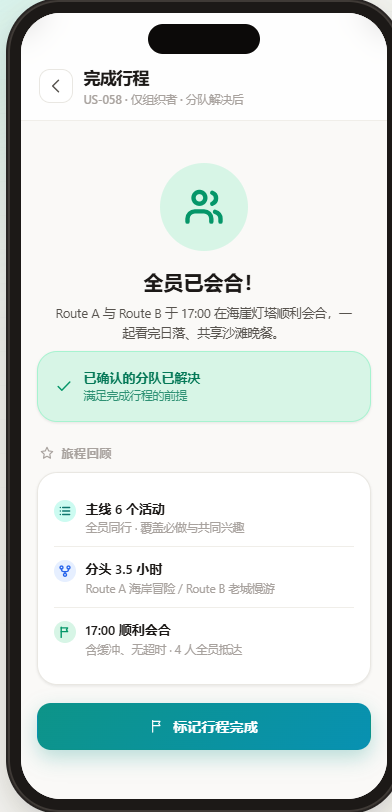

- **干什么**：组织者在分队解决后标记行程完成并归档。
- **布局与组件**：`confetti` 彩带层；`completeIdle`：成功环（users）「全员已会合！」+ 绿卡「已确认的分队已解决（满足完成前提）」+ 「旅程回顾」三行（主线 6 活动 / 分头 3.5 小时 / 17:00 顺利会合）+ 主按钮「标记行程完成」；`completeDone`（隐藏）：星形环「旅程已完成 🎉」+ 四头像归档卡「4 位朋友 · 2 天 · 1 次完美分队」+ 「返回仪表盘」。
- **状态与交互**：`completeTrip()` 切成功态 + 撒 48 片彩带（约 4.6s 后清理）+ toast「已归档」。
- **规则体现**：US-058「仅组织者、分队解决后才能完成」——前提绿卡先于完成按钮出现，完成才有庆祝反馈。

---

## 三、全局交互与状态

- **切屏**：`go(n)` 统一切换 `.screen.is-active` + 同步右侧导航高亮 + 滚动归零，并对进入的屏重置 / 触发对应状态（9 重置生成、10 跑校验、13 重置路线、15 重置分队、16 默认我的路线、18 重置完成）。
- **键盘**：`←` `→` 翻屏、`1`–`9` 直达前 9 屏（输入框聚焦时不拦截）。
- **校验动画**：生成 / 主线校验 / 分队再校验都用 `setTimeout` 分步把 `valid-item` 从 wait 变 pass，配合进度条，过程可解释。
- **倒计时**：`tick()` 每秒更新节点 16 的 HH:MM:SS 与节点 17 的 HH:MM 及进度条。
- **反馈**：所有操作给 `toast`（底部黑色圆角上浮）；成功给 `checkring` 弹性环；完成给 confetti。
- **隐私一致**：失效页不泄密、进行中不追踪、导航只指会合点——三处都用灰卡 + shield 图标统一表达。

## 四、演示数据设定

行程「周末海边游」· 青岛 · 黄金海岸 · 2026-11-14~15 · 青岛站→青岛北站 · 4 成员：小明（组织者 / teal / 水上·摄影·潜水 / ¥1200 软）、阿强（blue / 水上·冒险 / 必做潜水）、小红（amber / 咖啡·美食·慢游 / ¥600 硬）、小美（rose / 显式无偏好）。主线 6 活动；分队窗口 13:30 渔人码头→17:00 海崖灯塔（210 分钟）；Route A = 潜水 90 + 摩托艇 60 + 路程 40 + 缓冲 20；Route B = 咖啡 60 + 手作 60 + 拍照 40 + 路程 35 + 缓冲 15。

## 五、范围与后续移植

- **风格优先**：移植或新增代码时，UI 必须先对齐本参考当前风格（色彩令牌 / 圆角 / 阴影 / 组件 / 动效），再扩展功能，保证全站看起来是同一个产品。
- 本原型**只含 UI**：无后端、无持久化、无账号；所有「服务端校验 / 外部地图 / 分享」均为演示态。
- 移植到真实前端时（tech-stack：React + Vite + shadcn/ui + Tailwind）：把 `:root` 色彩变量映射为 Tailwind theme；18 个 `.screen` 拆为路由 / 组件；`valid-item / route / timeline / chip` 等对应 shadcn 组件组合；演示数据替换为 OpenAPI 契约接口。
- 截图均为当前原型自动采集的最新状态，存于 [`screenshots/`](screenshots/)（`screen-01`~`screen-18` + `overview-full`），改设计后请重新采集以保持图文一致。

## 六、验证记录

- 静态核对：18 屏齐全；JS 引用的元素 ID、SVG 图标、onclick 函数无缺失。
- 浏览器实测：逐屏点击创建 / 偏好 / 生成 / 确认 / 分队 / 导航 / 完成等主流程，控制台零报错，无布局溢出 / 图标缺失 / 按钮失效。
- 离线验证：`file://` 双击打开正常，确认零外部依赖。